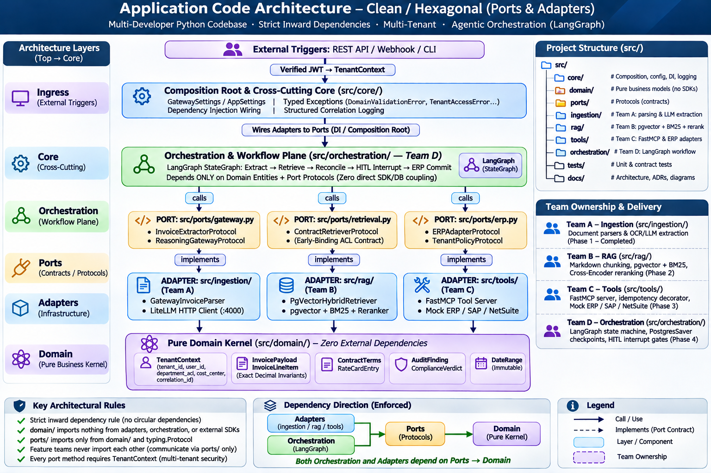
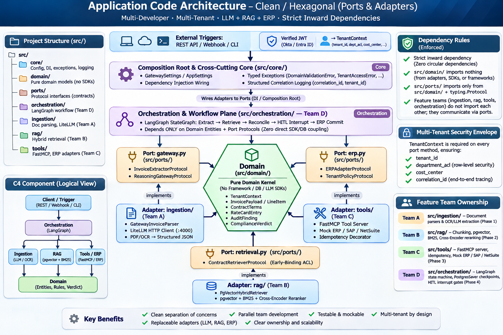

# System Architecture & Multi-Client Evolution Strategy

## 1. Enterprise Problem Statement

Global enterprises routinely lose **3% to 5% of total vendor spend** to contract non-compliance and invoice leakage. These losses occur in the gap between unstructured legal agreements—Master Services Agreements (MSAs), Statements of Work (SOWs), and rate card addenda—and structured Accounts Payable / ERP ledgers (SAP, NetSuite, Coupa).

### Specific Failure Modes Addressed
1. **Rate Card Inflation:** Vendors billing senior/principal hourly rates above contracted SOW caps (e.g., billing `$185/hr` against an approved `$150/hr` ceiling).
2. **Scope & Deliverable Drift:** Line items billed for out-of-scope services or unapproved travel/expense surcharges.
3. **Purchase Order (PO) Exhaustion & Duplicate Billing:** Invoices exceeding remaining committed PO balances or re-billing identical deliverables across billing periods.
4. **Manual Audit Bottlenecks:** Legal and procurement analysts manually cross-referencing multi-page PDFs against ERP records, creating multi-week approval delays.

### Why Naive LLM Implementations Fail in Production
* **Uncontrolled Egress & Vendor Lock-In:** Direct SDK calls from application code to model providers prevent centralized spend caps, fallback routing, and PII governance.
* **Cross-Department & Cross-Tenant Data Leakage:** Standard vector similarity search retrieves contract clauses without verifying user identity or department entitlements.
* **Non-Deterministic ERP Side Effects:** Linear prompt chains risk executing duplicate or hallucinated ERP payment updates during network retries or ambiguous edge cases.

---

## 2. Initial Architectural Baseline (Iteration 1: Single-Organization Governance)

We start with a **modular, five-plane architecture** designed so every external boundary—ingress identity, model egress, document retrieval, tool execution, and durable state—is strictly isolated behind typed interfaces:

1. **Ingress & Identity Boundary (API Gateway):** Authenticates users via OAuth 2.0 / OIDC (`Okta` / `Entra ID`) and extracts verified identity and department claims (`["legal"]`, `["procurement"]`, `["engineering"]`).
2. **Egress AI Gateway (`LiteLLM Proxy`):** All LLM inference and embedding calls route through a centralized proxy enforcing cost-center budgets, Redis semantic caching, PII filtering, and provider failover.
3. **ACL-Aware Hybrid RAG Engine (`pgvector` + `BM25`):** Stores contract clauses in PostgreSQL with `pgvector` and enforces **early-binding SQL `WHERE` filters** on department claims prior to hybrid vector/lexical retrieval and Cross-Encoder reranking.
4. **Deterministic Tool Plane (`FastMCP` + ERP Connector):** Exposes read/write ERP operations via Model Context Protocol (`FastMCP`) guarded by Pydantic v2 contracts, input sanitization, and an idempotency register.
5. **Durable State Runtime (`LangGraph` + `PostgresSaver`):** Manages compliance workflow state transitions with PostgreSQL checkpoint persistence and asynchronous Human-in-the-Loop (HITL) interrupts for discrepancies or invoices exceeding `$500`.

---

## 3. Multi-Client Scaling Roadmap (Future Iterations)

Starting with clean plane separation allows the platform to scale from a single enterprise deployment to a multi-client B2B architecture without rewriting core agent logic:

### Iteration 2: Multi-Tenant Data & Identity Isolation
* **Tenant-Scoped Metadata & Row-Level Security (RLS):** Extend the early-binding SQL `WHERE` filter from `department_acl` to composite `(tenant_id, department_acl)` keys backed by PostgreSQL Row-Level Security policies.
* **Per-Client Cryptographic & Vector Partitioning:** Isolate client contract corpora via tenant-partitioned tables or dedicated schemas in PostgreSQL while sharing the stateless retrieval service.

### Iteration 3: Per-Client Egress Governance & Model Policies
* **Tenant Virtual Keys & Spend Caps:** Provision isolated virtual API keys and rate limits per client inside `LiteLLM Proxy`, enabling strict per-client cost attribution and chargeback telemetry.
* **Client-Specific Model Routing & BYOK:** Allow regulated enterprise clients to route traffic to dedicated Azure OpenAI / AWS Bedrock endpoints or Bring-Your-Own-Key (BYOK) vaults via declarative gateway routing rules.

### Iteration 4: Pluggable ERP Connectors & Custom Policy Engines
* **Adapter Pattern on FastMCP:** Swap the initial Mock ERP backend for client-specific SAP S/4HANA, NetSuite, or Coupa adapters behind identical FastMCP tool schemas.
* **Declarative Approval Thresholds:** Externalize the `$500` HITL interrupt threshold and variance tolerances into per-client policy configurations evaluated dynamically by the `LangGraph` state machine.

## 4. Application Architecture

Application Code Architecture (Hexagonal / Ports & Adapters View)

  
## 5. Application Code Architecture (Hexagonal / Ports & Adapters)

### 5.1. Architectural Style & Dependency Inversion
To support concurrent multi-developer feature delivery and multi-tenant B2B SaaS scaling without structural refactoring, the Python runtime (`src/`) enforces **Clean / Hexagonal (Ports & Adapters) Architecture**:

- **Strict Inward Dependency Rule:** `src/domain/` is a pure business kernel with **zero** dependencies on frameworks, databases, or LLM SDKs (`openai`, `sqlalchemy`, `langgraph`).
- **Interface Seams (`typing.Protocol`):** `src/ports/` defines structural contracts (`InvoiceExtractorProtocol`, `ContractRetrieverProtocol`, `ERPAdapterProtocol`, `TenantPolicyProtocol`). Both `src/orchestration/` (LangGraph workflows) and infrastructure adapters (`src/ingestion/`, `src/rag/`, `src/tools/`) depend inward on `src/ports/` and `src/domain/`, never on each other.
- **Composition Root (`src/core/`):** Centralizes typed configuration (`GatewaySettings`), domain exception hierarchies, correlation logging, and dependency injection wiring.

### 5.2. Enterprise Invariants Enforced Across Layers

| Architectural Invariant | Enforcement Mechanism | Business & Governance Rationale |
| :--- | :--- | :--- |
| **Zero-Retrofit Multi-Tenancy** | Immutable `TenantContext` (`tenant_id`, `user_id`, `department_acl`, `cost_center`, `correlation_id`) required on every port signature. | Prevents cross-tenant data leakage via early-binding SQL `WHERE` / PostgreSQL RLS filters and enables per-tenant LiteLLM chargebacks. |
| **Deterministic FinOps Math** | Strict `decimal.Decimal` arithmetic with Pydantic v2 `@model_validator` cross-checks on line items and invoice totals. | Eliminates IEEE-754 floating-point drift and catches arithmetic discrepancies before reasoning models or ERP ledgers execute. |
| **Untrusted Input Isolation** | Authenticated `tenant_id` is injected from verified JWT claims (`TenantContext`), overriding any LLM-extracted tenant identifiers. | Neutralizes indirect prompt injection payloads embedded inside vendor invoice memos or line-item descriptions. |
| **Idempotent Side Effects** | Deterministic idempotency keys wrapping `ERPAdapterProtocol` write operations (`src/tools/`). | Guarantees exactly-once ERP mutations across LangGraph checkpoint retries or transient network failures. |

### 5.3. Parallel Feature Team Boundaries (`src/`)
- **Team A (`src/ingestion/`):** Document parsing and structured extraction adapters targeting the LiteLLM Egress Gateway.
- **Team B (`src/rag/`):** Markdown-aware contract chunking, `pgvector` + `BM25` hybrid search, early-binding ACL filtering, and Cross-Encoder reranking.
- **Team C (`src/tools/`):** FastMCP tool server, argument sanitization, idempotency decorators, and pluggable ERP adapters (Mock ERP / SAP / NetSuite).
- **Team D (`src/orchestration/`):** LangGraph `StateGraph` orchestration, `PostgresSaver` durable checkpoints, and asynchronous Human-in-the-Loop (HITL) approval gates.
